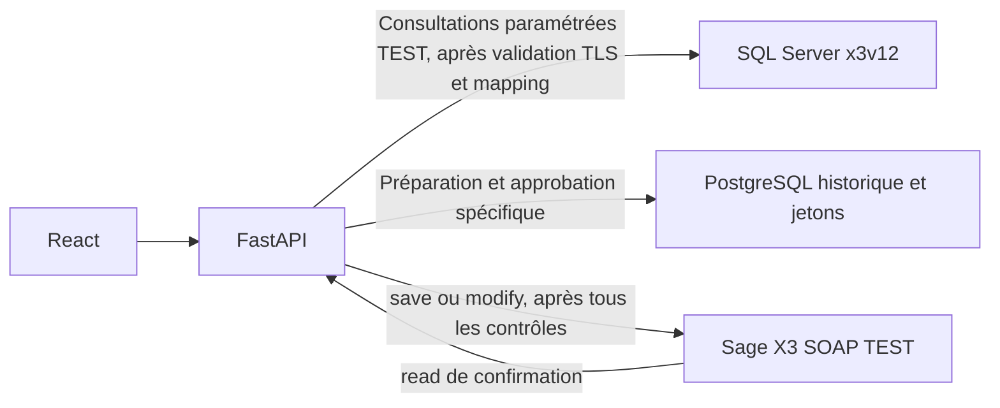

# Proposition : lectures SQL validées, écritures SOAP approuvées

État réel et plan détaillé : [rapport SQL Server](../logs/ETAPE-4-CONNEXION-SQL-SERVER.md).

La voie SQL n’est pas activée : certificat SQL non approuvé, session authentifiée et mapping non validés. Les connecteurs SOAP et routes GET actuelles sont conservés. Aucun INSERT/UPDATE/DELETE dans la base ERP, aucune donnée SQL envoyée automatiquement au modèle IA.

L’acceptation de la bascule exigera : identité d’instance/base et rôle effectif vérifiés, accès de lecture et absence de droits cumulés non nécessaires, tables/colonnes TEST inventoriées, comparaison SQL/SOAP réelle (dont traductions), cas absent et charge bornée testés, données renvoyées minimales, puis accord sur la bascule des GET.
