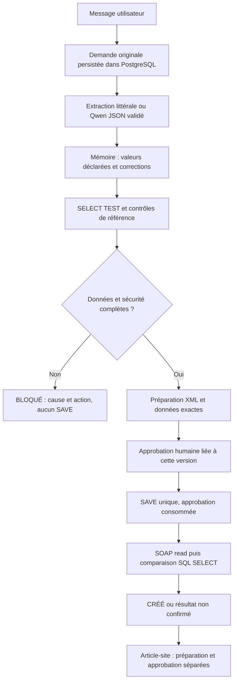

# CPJ345 Y45 — parcours de création article TEST

Audit et corrections du 30 octobre 2026. **Aucun SAVE réel exécuté. L'objectif de création réelle vérifiée reste ouvert.** Les créations contrôlées mentionnées ci-dessous sont des simulations de transport, pas des fiches Sage.

## État réel de CPJ345-Y45

Le SELECT exact sur `TEST.ITMMASTER` retourne zéro ligne, requête réussie : **CPJ345-Y45 absent lors de la dernière lecture**. Preuves : `reports/cpj345-references.json`, puis `reports/cpj345-final-readiness.json`, horodatées. Cela ne réserve pas le code ; un nouveau contrôle est obligatoire avant un futur SAVE.

La conversation demandait CPJ345 Y45, NEG, TVA 10, puis le site 101 corrigé en 201. Elle ne donnait aucune unité. **L n'était pas une valeur métier déclarée.** Il manque donc une unité explicitement choisie, ou une règle de défaut applicable et formellement vérifiée. Le défaut UN de la catégorie est une information de référence, pas une déclaration utilisateur.

## Causes confirmées et corrections

| Cause réelle | Localisation et correction |
|---|---|
| Le delta Qwen de la conversation enregistrée proposait `unite=L` sans déclaration. Le contrôle d'ancrage acceptait la lettre L dans « l'article ». | `conversation_chat.py:38`, `grounded` exige désormais un contexte d'unité explicite ou une réponse constituée du seul code unité. « un article » ne justifie pas UN. Delta original conservé dans `reports/cpj345-original-conversation.json`. |
| L'intention « créer l'article » demeurait une validation de brouillon sans orchestration générale prête à approuver. | `chat_article_requests.py:21`, `creation_request`, et `apply:87` enregistrent une intention sans autorisation d'écriture ; `conversation_chat.py:726`, `send`, appelle `chat_general_articles.py:96`, `maybe_prepare`, après persistance et vérifications. Une préparation automatique ne lance jamais SAVE. |
| Les limites d'anciens essais étaient présentées comme des règles générales. | `sage_powershell_chat.py`, `creation_blockers`, contient le préfixe TEST et NEG/UN, avec exceptions nominatives déjà existantes. `sage_article_sites.py`, `eligible`/`action`, contient le périmètre EXT_POUDRE. Ce sont des périmètres historiques d'exécution, pas des contraintes universelles de WS_ARTICLES. `article_execution.py:6`, `legacy_scope`, les conserve sur ce seul parcours ; les autres articles suivent `general_test`, avec sécurité stricte et règles revues. Aucune exception historique de révocation ou d'identité n'est étendue. |
| L'interface utilisait une sécurité globale et des actions de démonstration. | `frontend/src/ChatApp.jsx`, `Article` et `action`, utilisent maintenant la route et les contrôles de chaque article. `GeneralArticleActions.jsx`, `GeneralArticleActions`, présente les données exactes, une approbation spécifique et les opérations article-site distinctes. |
| Un taux SQL retrouvé pouvait être confondu avec son niveau de détermination applicable. | `scripts/chat_sql_queries.ps1:17`, outil SELECT `get_tax_determination_by_vat`. `article_execution.py:13`, `tax_review`, sépare défaut de catégorie, code taux et niveau candidat ; `article_mapping.py:8`, `request`, exige un contexte fiscal revu et daté, lié catégorie/site/société/régime/niveau. |

Le parcours historique PowerShell reste inchangé. Ses autorisations restreintes ne constituent pas une validation du nouveau parcours général. Les contrôles TEST, droits, certificat/révocation, politique d'exécution et approbation sont conservés.

## TVA : faits et décision nécessaire

Les lectures réelles TEST confirment :

- Catégorie NEG : unités de référence UN, niveau fiscal par défaut `T20`.
- Site 201 : société 20, OULD BOUAZZA.
- Taux `T10` à 10 %, et détermination `MAR_T10` active, régime `MAR`, niveau `T10`.

Ces faits ne démontrent pas à eux seuls l'applicabilité fiscale à CPJ345 Y45. Le défaut T20 n'est pas une interdiction démontrée de T10. **Il faut faire valider le niveau fiscal de cet article pour NEG/site 201/société 20 et la période concernée.** Aucun remplacement automatique de 10 par 20 ; aucun code TVA inventé. Les contextes utilisés dans les tests sont explicitement fictifs et ne sont pas installés comme règles TEST.

## Chaîne corrigée

`chat_general_articles.action:38` traite préparation, approbation et exécution avec propriétaire, révision, empreinte des données, contrôles renouvelés et permis serveur de 15 minutes. Le jeton n'est pas affiché au chatbot. Le marqueur d'exécution est commité avant l'appel SOAP ; `sage_crud.execute` consomme l'approbation à usage unique avant le transport. Une correction invalide la préparation et l'approbation (`conversation_chat.invalidate:159`). Une réponse « oui » dans le chat n'est pas une approbation SOAP.

La vérification finale (`article_readback.compare:12`) exige une création SOAP réussie, une fiche relue, un SELECT TEST réussi et l'égalité des champs réellement envoyés : code, désignation, catégorie, statut, unités, coefficients et taxes notamment. Le succès API seul est insuffisant. Un refus ou résultat ambigu ne déclenche aucune nouvelle tentative automatique.

`chat_general_sites.action:20` prépare chaque couple article/site séparément. Il vérifie le parent par SOAP/SQL, le site et sa société, l'absence de fiche enfant, puis un modèle de site revu et lié à la publication. Après une approbation distincte, il compare les champs de l'enfant par SOAP et SQL. Le succès du parent ne prouve jamais celui de l'enfant.

## Configuration métier générale

`sage_article_rules.load_rules:15` charge une preuve dont le chemin et le SHA256 sont inscrits dans la politique de sécurité. Elle doit être revue, non expirée, liée au dossier TEST, à V12 et au hash du descriptif SOAP. Aucun référentiel fictif n'a été activé.

Le mapping général utilise les catégories, combinaisons d'unités/coefficient, statuts, champs autorisés, gestion de stock et contextes fiscaux de cette preuve. Un fournisseur absent n'est pas rendu obligatoire arbitrairement : cela dépend de la règle revue de la catégorie. Un fournisseur demandé n'est jamais créé implicitement. Les champs ou associations non mappés restent bloqués, sans abandon silencieux de la demande.

Les modèles article-site sont distincts, sous la permission `article-sites/create`, avec société, champs obligatoires et mapping SQL de comparaison. Les tableaux et mappings non revus restent non pris en charge. Les droits et modèles réels doivent encore être approuvés par l'administrateur ; ils ne sont pas déduits d'un seul exemple historique.

## Vérifications exécutées

Les résultats définitifs chiffrés sont récapitulés dans `reports/cpj345-validation-summary.json` ; les fichiers JUnit et traces sont conservés, y compris les échecs intermédiaires.

- Nouveaux tests : conversation exacte propre et fautive, unité non inventée, site 101→201, catégorie/TVA conservées, verbes de création et faute CR2ER, unité M2/catégorie RAW/code hors démonstration, fournisseur facultatif, stock non géré autorisé par règle revue, TVA sans contexte refusée, doublon apparu après préparation, correction invalidant l'approbation, préparation interrompue sans perdre l'extraction.
- Transport contrôlé : SAVE confirmé avec comparaisons, refus, ambiguïté sans relance, article sans article-site, enfant approuvé séparément, refus de l'enfant sans faux succès global.
- Qwen réel local `qwen2.5:7b` : **3/3**, deux demandes sans unité et une avec UN. Durées 25,443 s, 11,850 s et 14,601 s ; premier chargement 14,950 s. Tokens entrée/sortie : 144/36, 152/58, 149/73. Ces essais forcent le modèle ; le parcours littéral normal évite cet appel pour les demandes couvertes. Preuve `reports/cpj345-real-qwen.json`.
- Navigateur contrôlé : approbation puis exécution article, statut incertain sans faux succès, approbation article-site séparée. Preuve `reports/cpj345-mocked-browser.json`.
- Navigateur réel + backend + SELECT TEST : ordinateur 1440 px et mobile 390 px, conversation CPJ complète, unité vide, site 201 conservé, blocage explicite sans limites de démonstration. Preuve `reports/cpj345-live-browser.json`. Aucun endpoint d'approbation/exécution autorisé par ce script.
- Non-régression backend isolée : SQL Server/SOAP/subprocessus interdits, PostgreSQL limité aux schémas de test locaux. Les trois tests locaux de subprocessus sont exécutés séparément. Frontend : 28 tests et build Vite exécutés.
- Campagne de 100 conversations simulées : provenance, nombre exact et résultat dans le récapitulatif ; ne pas confondre utilisateurs simulés, SQL simulé et essais Qwen réels.

Anomalies trouvées pendant le développement : mauvaise signature d'appel de `tool_plan` et écrasement d'une variable de conversation par une ligne fiscale, corrigés puis retestés. Quatre anciens tests de pont utilisaient implicitement l'ancienne route : ils ciblent maintenant explicitement ce pont en fixture ; les nouveaux tests valident la vraie route générale, sans affaiblir les contrôles. Le premier script navigateur attendait à tort qu'un bouton d'envoi vide soit actif ; attente corrigée sur la fin effective du job. Ces erreurs ne sont pas des preuves de créations Sage.

## Blocages réels et actions précises

| Blocage actuel | Action nécessaire |
|---|---|
| Unité absente de la demande CPJ | Choisir l'unité ou faire approuver un défaut réellement applicable ; ne pas appliquer L. |
| Applicabilité TVA 10 non certifiée pour cet article | Revue métier du contexte NEG/201/société 20, période et niveau fiscal ; conserver la demande à 10 tant que non décidée. |
| `CA_CRL_MATERIAL_REQUIRED` | Fournir la CRL signée et valide de SAGE-CA-2, vérifier signature, dates et révocation ; demande administrative déjà préparée dans `docs/DEMANDE-ADMIN-PKI-AIAGT-20261030.md`. |
| `VALID_ADMIN_SECURITY_EVIDENCE_REQUIRED` | Revue des droits AIAGT dans TEST et preuve de politique scoped ; les anciens profils ADMIN ne sont pas remplacés ici. |
| `WRITES_DISABLED` | Activation uniquement après validation administrative des contrôles, du périmètre et des règles. Aucun contournement HTTP 423. |
| Règles générales et article-site non signées pour exécution réelle | Valider les snapshots et descriptifs SOAP réellement applicables, sans copier automatiquement OB vers TEST. |
| Aucune approbation du payload final CPJ | Présenter les données finales après résolution des contrôles, puis obtenir l'approbation spécifique avant SAVE. |

Le backend local agent a été rechargé après contrôle de l'absence d'analyse récente en cours ; les six marqueurs `_pending` restants datent du 24 octobre et n'ont pas été modifiés. Aucun service Sage/production redémarré. Aucun certificat, droit Sage, fiche existante ou paramètre de production modifié.

**Conclusion opérationnelle : le parcours général est codé et vérifié en environnement contrôlé ; CPJ345-Y45 n'a pas été créé. La validation de bout en bout par un SAVE réel autorisé reste indispensable.** En cas de redémarrage, les permis en mémoire sont perdus de façon fermée ; une reprise administrative contrôlée est nécessaire pour une opération déjà approuvée, jamais un rejeu automatique.
